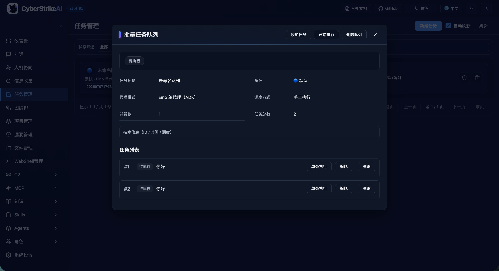
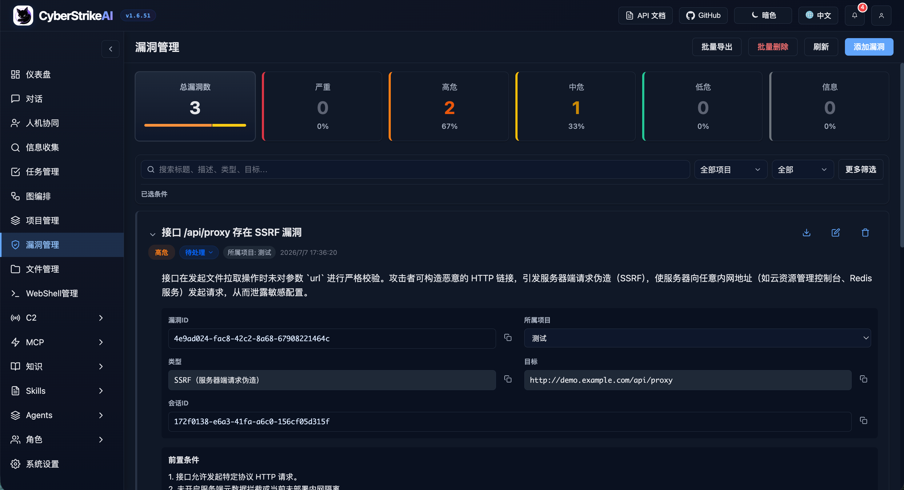
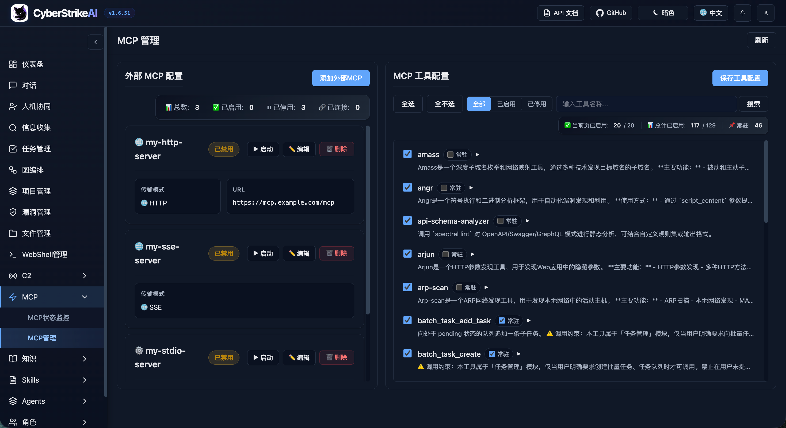
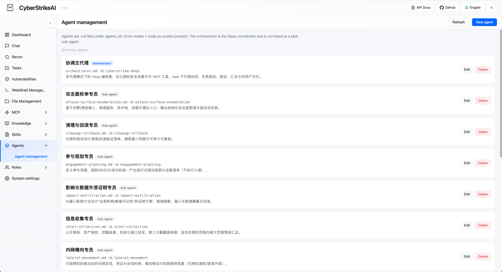
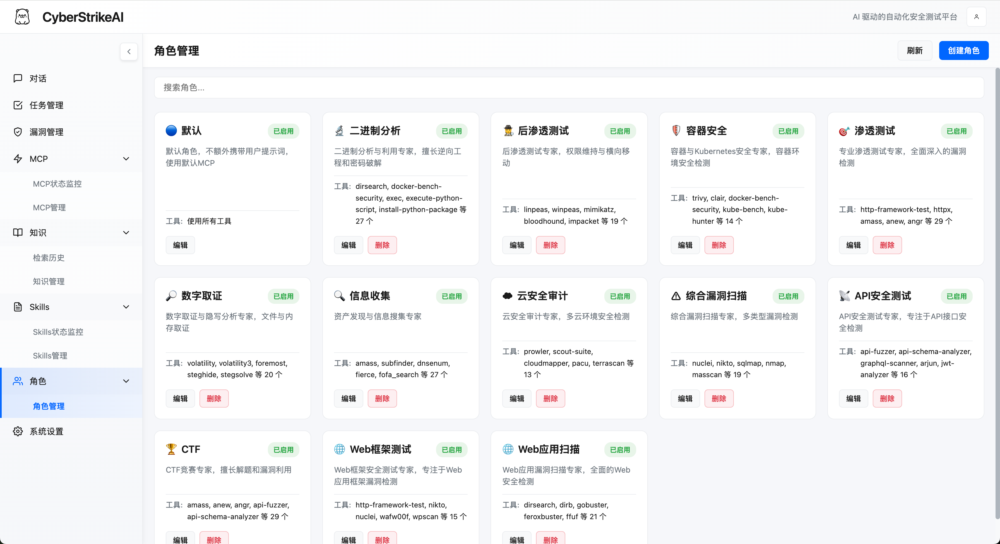

<div align="center">
  
</div>

<h1 align="center">ZREstrikeAI</h1>

<p align="center">
  <strong>AI-native security operations platform — where intent becomes governed execution,<br>
  evidence becomes operational memory, and every operation improves the next.</strong>
</p>

<p align="center">
  <a href="README_CN.md">中文文档</a> ·
  <a href="docs/en-US/README.md">Documentation</a> ·
  <a href="#quick-start">Quick Start</a> ·
  <a href="#configuration">Configuration</a> ·
  <a href="#license-and-attribution">License</a>
</p>

<p align="center">
  
  
  
  
</p>

---

## Overview

ZREstrikeAI is a self-hosted platform for **authorized** security operations. It unifies planning, execution, human oversight, evidence collection, and replay into a single auditable workspace, so that every action an AI agent takes is governed, reviewable, and reproducible.

Built in Go with [Eino](https://github.com/cloudwego/eino)-powered agents, it combines multi-agent orchestration, MCP-native tooling, RAG knowledge retrieval, visual graph workflows, and attack-chain modeling.

| | |
|---|---|
| **Language** | Go 1.25+ / Python 3.10+ |
| **Agent runtime** | Eino — single-agent, Deep, Plan-Execute, Supervisor |
| **Tool protocol** | MCP (HTTP / stdio / SSE / external federation) |
| **Interfaces** | Web console, REST API, MCP stdio, chatbot bridges |
| **License** | Apache-2.0 |

---

## Key Capabilities

### Agent orchestration

- **Intent-to-action pipeline** — natural-language objectives are translated into governed, auditable security actions.
- **Four execution modes** — single agent, Deep reasoning, Plan-Execute, and Supervisor multi-agent coordination.
- **Graph workflows** — compose agents, tools, conditions, approvals, and outputs into reusable flows.
- **Role-scoped testing** — 14 predefined roles with focused prompts and per-role tool policies.

### Tools and knowledge

- **90+ curated tool recipes** — declarative YAML definitions with custom extensions and role-scoped access.
- **MCP-native integration** — HTTP, stdio, SSE, external federation, and dynamic tool discovery.
- **Resilient execution** — blocking tool calls run in workers with bounded waits, resumable `execution_id` polling, cancellation, per-server circuit breakers, and concurrency limits.
- **Agent Skills** — standard `SKILL.md` layout with progressive, on-demand loading (24 shipped).
- **RAG knowledge base** — query rewriting, vector retrieval, reranking, and result post-processing.
- **Vision analysis** — a dedicated vision model handles screenshots, captchas, and UI, retaining text summaries only.

### Governance and audit

- **Human in the loop** — approval modes, tool allowlists, audit-agent review, and traceable decision records.
- **Platform RBAC** — multi-user support with system and custom roles, scoped permissions, and explicit ownership.
- **Evidence retention** — authenticated access, audit logs, SQLite persistence, and capped tool-result storage.
- **Result governance** — the agent sees exactly the capped result that is stored, preventing oversized historical output from breaking resume paths. See [Tool Execution Governance](docs/en-US/tool-execution-governance.md).

### Security operations

- **Asset management** — normalize and deduplicate domains, IPs, ports, and services; XLSX/CSV import and export, saved views, cross-page bulk maintenance, and scan-coverage tracking. See the [Asset Management guide](docs/en-US/asset-management.md).
- **Vulnerability management** — severity classification, lifecycle tracking, filtering, and statistics.
- **Projects and attack chains** — cross-session fact linking, risk scoring, graph views, and step-by-step replay.
- **Batch tasks** — queued execution, editing, status tracking, and retained results.
- **WebShell management** — connection management, virtual terminal, file operations, and AI-assisted workflows.
- **Built-in C2** — listeners, encrypted beacons, session handling, task queues, and payload helpers.
- **Chatbot bridges** — Personal WeChat, WeCom, DingTalk, Lark, Telegram, Slack, Discord, and QQ Bot.

> WebShell, C2, and other high-risk capabilities are intended **only** for systems you own or have explicit written authorization to test. Review the [security model](docs/en-US/security-model.md) and [hardening guide](docs/en-US/security-hardening.md) before enabling them.

---

## Screenshots

<div align="center">

<table>
<tr>
<td width="50%" align="center"><strong>Dashboard — Light</strong><br>
</td>
<td width="50%" align="center"><strong>Dashboard — Dark</strong><br>
</td>
</tr>
</table>

<details>
<summary><strong>More screenshots</strong></summary>
<br>

<table>
<tr>
<td width="33.33%" align="center"><strong>Web Console</strong><br></td>
<td width="33.33%" align="center"><strong>Task Management</strong><br></td>
<td width="33.33%" align="center"><strong>Vulnerability Management</strong><br></td>
</tr>
<tr>
<td width="33.33%" align="center"><strong>WebShell Management</strong><br></td>
<td width="33.33%" align="center"><strong>MCP Management</strong><br></td>
<td width="33.33%" align="center"><strong>Knowledge Base</strong><br></td>
</tr>
<tr>
<td width="33.33%" align="center"><strong>Skills</strong><br></td>
<td width="33.33%" align="center"><strong>Agents</strong><br></td>
<td width="33.33%" align="center"><strong>Roles</strong><br></td>
</tr>
<tr>
<td width="33.33%" align="center"><strong>Settings</strong><br></td>
<td width="33.33%" align="center"><strong>MCP stdio Mode</strong><br></td>
<td width="33.33%" align="center"><strong>Burp Suite Plugin</strong><br></td>
</tr>
</table>

</details>

</div>

---

## Project Layout

```
ZREstrikeAI/
├── cmd/                 # Entrypoints: server, MCP stdio, tooling
├── internal/            # 31 packages — agent, multiagent, mcp, eino*, c2, hitl, knowledge, security, workflow
├── web/                 # Web console (static SPA + templates)
├── tools/               # 90 declarative YAML tool recipes
├── roles/               # 14 predefined security testing roles
├── skills/              # 24 Agent Skills (SKILL.md layout)
├── agents/              # 16 multi-agent definitions (orchestrator + sub-agents)
├── plugins/             # Burp Suite extension, Chrome/Edge extension
├── docs/                # 32 EN / 34 ZH topic documents
├── images/              # Screenshots and diagrams
├── config.example.yaml  # Configuration template
├── run.sh               # One-command launcher
├── run-all.sh           # Full-stack launcher
└── upgrade.sh           # In-place upgrade
```

---

## Quick Start

**Prerequisites**

- **Go 1.25+** — [download](https://go.dev/dl/)
- **Python 3.10+** — [download](https://www.python.org/downloads/)

**One-command deployment**

```bash
git clone https://github.com/1276486/ZREred.git
cd ZREred
chmod +x run.sh && ./run.sh
```

`run.sh` will check the Go and Python toolchains, create the Python virtual environment, install dependencies, download Go modules, build the binary, and start the server.

**Verify startup**

1. The terminal prints `● ONLINE` followed by the Web UI URL.
2. Open that URL. The default HTTPS mode uses a local self-signed certificate — accept the browser warning once.
3. On a fresh install, copy the one-time `admin` password shown under `ADMIN SETUP REQUIRED`, sign in, and change it immediately.

**Networking defaults** — `run.sh` starts the server with `--https` using `config.yaml` (self-signed TLS, better for many concurrent streams). Use `./run.sh --http` for plain HTTP. In production, set `server.tls_cert_path` and `server.tls_key_path` in `config.yaml`. For manual runs, pass `--https` or set `CYBERSTRIKE_HTTPS=1`.

**Alternative launch methods**

```bash
# Direct Go run
go run cmd/server/main.go --https

# Manual build (same output name as run.sh)
go build -o cyberstrike-ai cmd/server/main.go
./cyberstrike-ai --https
```

If the log shows `client sent an HTTP request to an HTTPS server`, a client is still using `http://` against a TLS-only port — switch the URL to `https://`.

---

## Configuration

Use [`config.example.yaml`](config.example.yaml) as the authoritative template and copy only the values your environment needs. At minimum, configure the server and one AI channel:

```yaml
server:
  host: "127.0.0.1"
  port: 8080

ai:
  default_channel: openai-main
  channels:
    openai-main:
      provider: openai_compatible
      api_key: "${OPENAI_API_KEY}"
      base_url: "https://api.openai.com/v1"
      model: "your-model"
```

The legacy `openai` top-level field is retained for backward compatibility; configure new models under `ai.channels`. `ai.default_channel` is used for new conversations and for tasks that do not select a channel explicitly — the chat page can still override per session.

> **Never commit real credentials.** `config.yaml`, `data/`, and `chat_uploads/` are excluded by [`.gitignore`](.gitignore). Provide secrets through environment variables such as `${OPENAI_API_KEY}`.

Review the [configuration reference](docs/en-US/configuration.md), [recommended profiles](docs/en-US/configuration-profiles.md), and the [security hardening guide](docs/en-US/security-hardening.md) before exposing the service beyond localhost.

**Security tools (optional)** — install from `tools/` as needed; missing tools are skipped or substituted at runtime.

```bash
# macOS
brew install nmap masscan sqlmap nikto gobuster ffuf hydra hashcat nuclei subfinder

# Debian / Ubuntu / Kali
sudo apt update
sudo apt install -y nmap masscan sqlmap nikto gobuster hydra hashcat john binwalk
# ffuf / nuclei / subfinder are typically installed via `go install` or upstream releases
```

---

## Tool Coverage

ZREstrikeAI ships with 90 curated tool recipes spanning the full kill chain.

<details>
<summary><strong>View all tool categories</strong></summary>
<br>

| Category | Tools |
|---|---|
| Network scanning | nmap, masscan, rustscan, arp-scan, nbtscan |
| Web & app scanning | sqlmap, nikto, dirb, gobuster, feroxbuster, ffuf, httpx |
| Vulnerability scanning | nuclei, wpscan, wafw00f, dalfox, xsser |
| Subdomain enumeration | subfinder, amass, findomain, dnsenum, fierce |
| Internet-wide search | fofa, zoomeye, quake, shodan |
| API security | graphql-scanner, arjun, api-fuzzer, api-schema-analyzer |
| Container security | trivy, clair, docker-bench-security, kube-bench, kube-hunter |
| Cloud security | prowler, scout-suite, cloudmapper, pacu, terrascan, checkov |
| Binary analysis | gdb, radare2, ghidra, objdump, strings, binwalk |
| Exploitation | metasploit, msfvenom, pwntools, ropper, ropgadget |
| Password cracking | hashcat, john, hashpump |
| Forensics | volatility, volatility3, foremost, steghide, exiftool |
| Post-exploitation | linpeas, winpeas, mimikatz, bloodhound, impacket, responder |
| CTF utilities | stegsolve, zsteg, hash-identifier, fcrackzip, pdfcrack, cyberchef |
| System helpers | exec, create-file, delete-file, list-files, modify-file |

</details>

See [`tools/README_EN.md`](tools/README_EN.md) for recipe definitions, customization, and usage notes.

---

## Plugins

Optional integrations live under `plugins/`.

**Burp Suite extension** — capture and forward authenticated traffic into ZREstrikeAI for AI-assisted analysis.

```
Source:  plugins/burp-suite/cyberstrikeai-burp-extension/
Output:  plugins/burp-suite/cyberstrikeai-burp-extension/dist/cyberstrikeai-burp-extension.jar
Docs:    plugins/burp-suite/cyberstrikeai-burp-extension/README.md
```

**Browser extension (Chrome / Edge)** — capture DevTools network traffic and forward it to ZREstrikeAI, aligned with the Burp plugin.

```
Source:   plugins/browser-extension/cyberstrikeai-browser-extension/
Install:  chrome://extensions/ → Load unpacked → F12 → "CyberStrikeAI" tab
Package:  plugins/browser-extension/cyberstrikeai-browser-extension/dist/cyberstrikeai-browser-extension.zip
Docs:     plugins/browser-extension/cyberstrikeai-browser-extension/README.md
```

---

## Usage Examples

**Direct requests**

```
Scan open ports on 192.168.1.1
Perform a comprehensive port scan on 192.168.1.1 focusing on 80,443,22
Check if https://example.com/page?id=1 is vulnerable to SQL injection
Scan https://example.com for hidden directories and outdated software
Enumerate subdomains for example.com, then run nuclei against the results
```

**Multi-step playbooks**

```
Load the recon-engagement template, run amass/subfinder, then brute-force directories on every live host.
Use an external Burp-based MCP server for authenticated traffic replay, then pass findings back for graphing.
Compress the 5 MB nuclei report, summarize critical CVEs, and attach the artifact to the conversation.
Build an attack chain for the latest engagement and export the node list with severity >= high.
```

---

## Documentation

| Audience | Reading order |
|---|---|
| **New users** | [Deployment](docs/en-US/deployment.md) → [Configuration](docs/en-US/configuration.md) → [Troubleshooting](docs/en-US/troubleshooting.md) |
| **Operators** | [Configuration profiles](docs/en-US/configuration-profiles.md) → [Security hardening](docs/en-US/security-hardening.md) → [Runbooks](docs/en-US/runbooks.md) |
| **Integrators** | [API reference](docs/en-US/api-reference.md) → [API recipes](docs/en-US/api-recipes.md) → [MCP federation](docs/en-US/mcp-federation.md) |
| **Contributors** | [Developer guide](docs/en-US/developer-guide.md) → [Testing](docs/en-US/testing.md) → [Contributing](docs/en-US/contributing-guide.md) |

Full indexes: [English](docs/en-US/README.md) · [Bilingual](docs/README.md)

---

## Upgrade

```bash
chmod +x upgrade.sh          # first time only
./upgrade.sh --yes           # optional flags: --tag vX.Y.Z, --no-venv
```

The script backs up `config.yaml` and `data/`, syncs code from the release source, updates the `version` field, and restarts the server. Local `tools/`, `roles/`, and `skills/` are always preserved. To restore, copy back from `.upgrade-backup/` and re-run `./run.sh`.

**Requirements** — `curl` or `wget` for downloads; `rsync` recommended for safe code sync. If the GitHub API rate-limits you, export `GITHUB_TOKEN` first.

> **Before upgrading**, review the target release notes for configuration, database, and API changes. Back up even for patch upgrades — a version number alone is not a compatibility guarantee.

---

## Security and Responsible Use

This project is a professional security testing platform intended for security researchers, penetration testers, and IT professionals conducting assessments **with explicit authorization**.

**By using this software you agree to:**

- Test only systems for which you hold clear, written authorization
- Comply with all applicable laws, regulations, and professional standards
- Accept full responsibility for any unauthorized or improper use

High-risk capabilities — WebShell, C2, credential attacks, post-exploitation tooling — are gated behind explicit configuration and RBAC. Keep the console bound to `127.0.0.1` or a trusted network, and review the [security model](docs/en-US/security-model.md) before enabling them.

For vulnerability reports and hardening guidance, see [SECURITY.md](SECURITY.md).

---

## License and Attribution

Licensed under the **Apache License 2.0** — see [LICENSE](LICENSE) for the full text.

ZREstrikeAI is a derivative work based on [CyberStrikeAI](https://github.com/Ed1s0nZ/CyberStrikeAI), also licensed under Apache-2.0. Rebranding, refactoring, and feature extensions are maintained by [@1276486](https://github.com/1276486). In accordance with Apache-2.0 §4, all original copyright, patent, trademark, and attribution notices are retained unmodified.

Third-party tool names referenced in this document remain the property of their respective owners.

---

## Contributing

Issues and pull requests are welcome. For non-trivial changes, open an issue first so the approach can be discussed before implementation.
